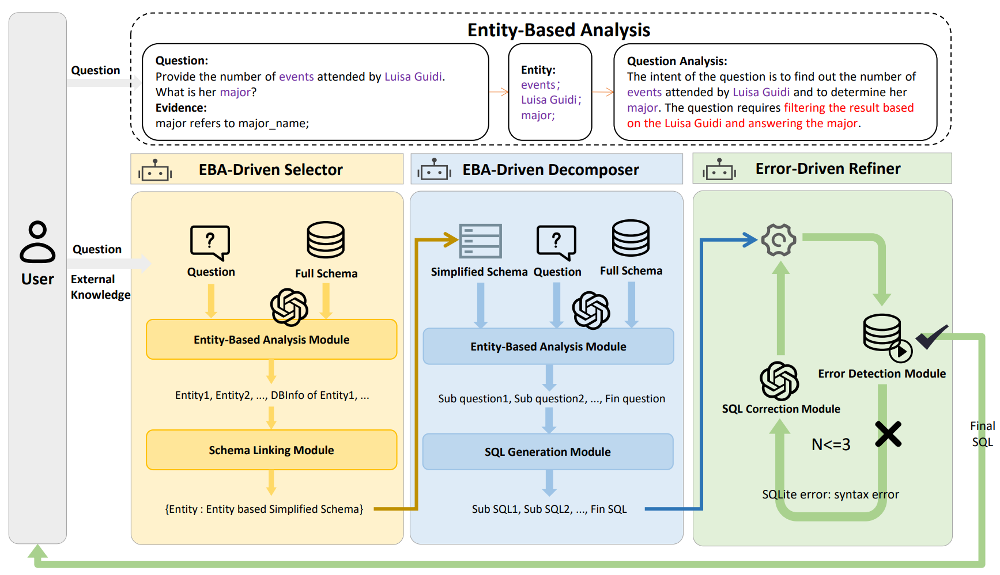

# EBA-SQL: A Multi-Agent Collaborative Framework with Entity-Based Analysis for Text-to-SQL 


## Introduction
In this paper, we propose **Entity-Based Analysis (EBA)**, a novel strategy to improve LLMs' question understanding and attention. Furthermore, we introduce EBA-SQL, a multi-agent collaboration framework based on this strategy, which comprises three agents: the **EBA-Driven Selector**, the **EBA-Driven Decomposer**, and the **Error-Driven Refiner**.

<p align="center">
  
</p>


## Full Intro.
The in-context learning capability of Large Language Models has achieved significant success in text-to-SQL tasks. Most existed approaches generally adopt a straightforward three-stage workflow including 1) schema linking, 2) SQL generation, and 3) self-correction. However, processing subtasks through a single chain-of-thought prompt limits the reasoning capability of LLMs. In this paper, we propose a novel Entity-Based Analysis strategy to improve LLMs' understanding and attention of question. Then, a multi-agent collaboration framework EBA-SQL is introduced, where the Logic-Driven Decomposer agent acting in the Entity-Based Analysis strategy is the core component for question decomposition and SQL generation. Two auxiliary agents, the Logic-Driven Selector and the Error-Driven Refiner, are responsible for schema linking and self-correction, respectively. Experimental results demonstrate the effectiveness and efficiency of EBA-SQL. Specifically, experiments on the BIRD dataset show that EBA-SQL achieves the state-of-the-art performance with an execution accuracy of 63.50\% on the test set among the open-source GPT-4 based text-to-SQL methods. Extensive analysis and ablation studies confirm that EBA-SQL outperforms the baselines with respect to token and time efficiency, thus to demonstrate the strong potential for practical applications.

## ⚡Environment

Config your local environment.

```bash
conda create -n EBASQL python=3.9 -y
conda activate EBASQL
cd EBA-SQL
pip install -r requirements.txt
python -c "import nltk; nltk.download('punkt')"
```

Note: we use `openai==0.28.1`, which use `openai.ChatCompletion.create` to call api.


## 🔧 Data Preparation

The main dataset we used is BIRD(https://bird-bench.github.io/) and Spider(https://yale-lily.github.io/spider)

In order to prepare the data more quickly, the `bird dev set related files` should be in `data/bird/dev/`,  the `spider set related files` should be in `data/spider/`.

For more details, please refer to `🌟 Project Structure`.


## 🚀 Run

We provide the run script.
You should open code comments for different usage.

- `run.sh` for Linux/Mac OS.
- `run.bat` for Windows OS.
- `run_spider.bat` for spider dataset.

For BIRD Dev, enable parallel question processing with:

```bash
bash run_bird_dev.sh --workers 4
# Equivalent: WORKERS=4 bash run_bird_dev.sh
```

The default is one worker (serial). Each process has its own agents and logs;
parallel logs and API traces go into `worker_<pid>/` beside the configured log
file. Initialization is serialized to protect shared caches. The parent appends
results as questions finish; evaluation output is sorted by input index.
Existing predictions are skipped on restart, while failed items are retried.


## 📝Evaluation Dataset
We provide the script for Linux systems and Windows systems.

**run_evaluation.sh** and **run_evaluation.bat**.

To create a separate Spider prediction file without backtick identifiers while
preserving the original prediction, run:

```bash
python scripts/remove_sql_backticks.py \
  outputs/ebasql_spider_dev_qwen3.6-35b-a3b/pred_dev.sql
```

The default output is `pred_dev_no_backticks.sql` beside the input file. Pass
`--force` explicitly if an existing derived file should be replaced.

## 🌟 Project Structure

```txt
├─data # store datasets and databases
|  ├─bird
|  |  ├─dev    # store bird dev set and dev databases
|  |  ├─test   # store bird test set and test databases
|  ├─spider    # store spider set
├─core
|  ├─agents.py       # define three agents class
|  ├─agents_difficult.py # define two difficult agents class
|  ├─api_config.py   # OpenAI API ENV config
|  ├─bridge_content_encoder.py
|  ├─chat_manager.py # manage the communication between agents
|  ├─const.py        # prompt templates and CONST values
|  ├─llm.py          # api call function and log print
|  ├─utils.py        # utils function
|  ├─utils_difficult.py        # difficult utils function
├─evaluation # evaluation scripts
|  ├─evaluation.py
|  ├─evaluation_spider.py
|  ├─evaluation_ves.py
|  ├─exec_eval.py
|  ├─parse.py
|  ├─process_sql.py
├─scripts
|  ├─remove_sql_backticks.py # create a derived prediction without backticks
├─evaluation_bird_ex.sh # bird evaluation script in Linux
├─evaluation_bird_ex.bat # bird evaluation script in Windows
├─README.md
├─requirements.txt
├─run.bat # generation and evaluation script in Windows
├─run.py # main run script
├─run.sh # generation and evaluation script in Linux
├─run_spider.bat # run script for spider dataset
```

## Generation cost logs

`run_bird_dev.sh` uses an explicit `RUN_ID=cost_run_1` in both the output directory
and prediction filename. Select the model and endpoint before running. Start a
fresh directory for complete cost coverage; resuming cannot recover usage for
previously completed questions.

`run.py` now writes the following alongside predictions:

- `llm_attempts.jsonl`: process-locked request attempts with stage, model,
  session/execution/call IDs, retry number, input/output/reasoning tokens,
  finish reason, elapsed time, prompt hash, and exception class. Worker
  initialization (including its network probe) is labeled
  `scope=worker_initialization` rather than assigned to a question.
- `question_costs.jsonl`: worker execution time and success/exception outcome,
  including failed executions. Prediction records also gain `exec_time` and
  `execution_id`. Success here means the pipeline returned, not correct SQL.
- `run_sessions.jsonl`: append-only invocation settings, input/code hashes,
  model, token-limit environment setting, status and wall time.
  `run_config.json` and `run_time.json` describe the latest invocation only.

The three-attempt outer loop and existing resume rule are preserved: records
containing `pred` are skipped; records without it are retried. Retain all request
records across retries/resumes when calculating consumed cost. The SDK may retry
internally, so these are SDK invocations rather than a guaranteed count of HTTP
requests. Missing usage is null; valid content without usage no longer causes a
retry merely because token fields are absent. Legacy cumulative counters sum
known usage only. Reasoning tokens must not be added to completion tokens blindly.

Question time includes pipeline work and failure/retry sleeps, excluding queueing
and worker initialization. Invocation time includes initialization and export.
Neither is GPU time. Shared initialization/cache costs must be included once in
whole-run cost, not discarded for lacking question IDs. Exception messages are
reduced to their classes in the request/error logs to avoid credential leakage.

A run-directory lock rejects simultaneous runs to the same output directory;
it does not validate experiment identity. Keep model, settings, data and code
unchanged for resumes. Abrupt termination can leave a partial last JSONL line
or omit the session finalization; inspect logs before aggregation.

Offline validation (mock requests, no inference):

```bash
python -m unittest discover -s tests -v
bash -n run_bird_dev.sh
```
